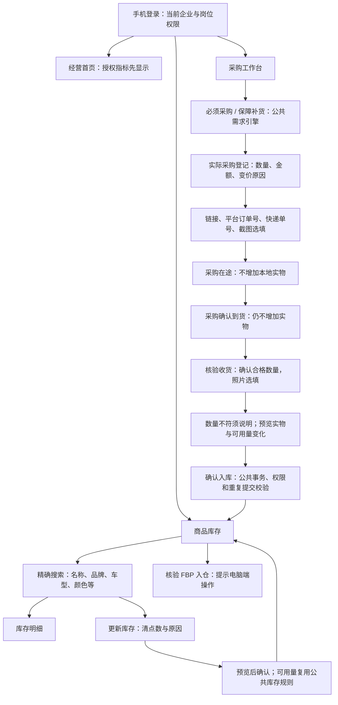

# 手机工作台开发与验收

基线：2026-11-01 从 origin/release/2026.10.21-task-brand（e68b316）创建 codex/mobile-workbench-v2。
交付边界：本地开发、独立测试库验证、开发分支提交。用户审阅确认后才允许合并 release 和部署 ECS。

## 本轮任务

| 编号 | 任务 | 验收标准 | 状态 |
| --- | --- | --- | --- |
| M1 | 统一手机布局与导航 | 首页/采购/库存/订单/我的按岗位显示；窄屏无横向溢出；输入控件字号至少16px；手机操作不跳电脑版 | 本地完成 |
| M2 | 按权限的经营首页 | 员工营业额/有效订单/取消/退件/广告回报/当月销量；有财务权限才返回利润、采购、广告费用及库存金额；慢任务不阻塞已有指标 | 本地完成 |
| M3 | 手机采购登记 | 复用统一需求引擎和实际采购服务；可空白新增及搜索添加；链接、采购订单号、物流单号分字段；允许手动输入、粘贴和截图凭证；价格波动原因有效 | 本地完成 |
| M4 | 收货与拍照验收 | 按批次确认到货；验收合格数量才入库；拍照/相册选择均可选，预览删除、压缩和失败重试；仅已确认到货进入手机核验；照片保存到相应单据；差异须有原因；失败保留输入 | 本地完成 |
| M5 | 库存精确搜索及盘点 | 共用库存搜索语义；展示图片/编码/类型/组成；查找后填写实物数，预览前后数量和可用量，再确认；权限/并发冲突/重复提交校验沿用公共服务 | 本地完成 |
| M6 | 安装与回归 | 提供添加主屏幕入口/说明；不缓存私有接口响应；A/B隔离、越权、上传边界、重复提交、宽窄屏验证；构建和编码检查通过 | 本地通过，真机待验收 |

## 公共逻辑与安全边界

- 不另造库存数量或采购优先级公式：FBS真实需求 → 本地安全保障 → 正式FBP备货申请。预测仅建议；采购在途只抵扣一次。
- 不修改冻结利润公式，不回算旧订单，不调用真实Ozon同步、收费AI或生产OSS写入。
- 权限依当前企业成员和岗位；企业管理员不推断平台授权。后端必须裁剪员工无权查看的金额。
- 手机确认到货不等于验收合格；FBP官方数量不通过本地盘点修改。
- 凭证按企业授权访问，不能用外企业附件或任意URL写入记录。截图识别/OCR、第三方APP自动抓取、本轮不上架原生APP。
- 图片失败不清空表单；成功以服务端回执为准，重复点击不能重复记账。弱网时禁止把本地未提交内容当作保存成功。
- 订单功能复用现有手机查询与详情；本轮不重做打印/发货规则。

## 验收分层

1. 纯函数/组件：粘贴字段、图片校验、分页/竞态、状态颜色、失败保留。
2. 独立MySQL：采购/到货/验收入库/盘点前后账实、幂等、差异理由、企业A/B和岗位越权。
3. 浏览器：真实Vue手机页面，窄屏与桌面宽度；各入口不跳桌面；照片选择/预览；操作后数量与状态刷新。
4. 人工设备验收：iPhone相机、相册、HEIC输入及Android相机/返回/安装；未实机验证必须明确标记。
5. 最终逐项记录证据，区分本地通过、开发分支提交、合并release、部署ECS、真实业务验收。本轮仅允许前两项。

## 2026-11-01 最终页面与流程

库存页分为「商品库存」「核验收货」「核验 FBP 入仓」三个标签。商品列表提供「库存明细」「更新库存」；只有现有岗位含 inventory.write 才显示更新按钮。仓库打包岗位可以验收入库，不自动获得盘点或采购权限，需要企业按实际职责授权。

「核验收货」仅展示采购已确认到货的批次（status=arrived），不会把采购满三天误认成已到仓。采购工作台的待验收队列仍可提示采购满三天需检查。照片选填，不拍照也可确认；上传失败时需重试或移除失败项才可继续。FBP手机标签只说明电脑端核验入口，不提供手机入仓确认；系统不会自动代仓库确认。



采购链接分享文字仅提取有效链接，不自动抓取1688或拼多多；截图作为凭证，数量金额仍须人工确认。采购截图复用本企业私有附件，平台订单号与图片引用记录在原采购备注，快递信息进入原采购物流记录；不新建另一套采购账。验收照片写入原入库批次 receipt_images_json；部分入库只给合格部分挂载照片。

首页实际采购和库存金额独立请求，慢查询不会阻塞已返回的营业额及订单指标。库存金额沿用月账单口径，包含本地、FBP和采购在途。库存列表按20项分页；本地数量单独批查；更新库存仅读取本地账与本地规则，避免等待各店铺FBP库存。盘点预览复用 inventoryWorkflow 的安全保障扣除口径；规则未知显示待核实，不按0猜测。

## 本地验收记录

- 43项纯函数、权限、附件边界、安装清单、响应式及现有采购/收货回归全部通过（0失败、0跳过）。
- 独立临时MySQL共29项全部通过（0失败、0跳过）：采购登记不增实物、确认到货不增实物、部分验收仅增加合格数量、照片归属验证、重复采购/盘点不重复记账、价格波动原因、新旧收货状态、企业A/B财务与私有文件隔离。
- 浏览器加载真实Vue组件，使用明确的本地模拟接口；与上述真实MySQL验证分开，不冒充生产或完整HTTP联调。375/390/430及1366宽度检查无横向溢出；输入16px；首页慢财务请求时已有指标先显示；仓库岗位不请求财务分段，不显示采购/盘点按钮。
- 浏览器实际操作通过：空白采购表搜索添加、分享链接提取、变价原因提交、盘点预览保存后列表刷新、照片首传失败保留数量并禁止确认、重试后照片随批次提交、不拍照也能入库、三个库存标签及FBP电脑端提示。
- 最终构建、check:encoding、check:sql-bindings、check:frontend-safety、docs:api:check及git diff --check通过。构建仍提示原有AI工作台代理资产和大包体积，未修改这些无关模块。

复验命令：

```sh
DB_HOST=127.0.0.1 DB_NAME=unused_test DB_USER=root node --test test/mobile-workbench.test.js test/mobile-install.test.js test/mobile-responsive-shell.test.js test/inventory-workflow-completion.test.js test/tenant-private-static.test.js test/order-receipt-button.test.js test/order-procurement-receipt-quantity.test.js test/procurement-price-reason.test.js
# 指向本机独立MySQL测试实例；测试自行建立并清理临时库，禁止指向生产。
TENANT_TEST_MYSQL_SOCKET=/path/to/local/mysql.sock node --test --test-concurrency=1 test/mobile-procurement-mysql.test.js test/procurement-batch-price-reason-mysql.test.js test/tenant-receipt-item-status-mysql.test.js test/tenant-finance-private-files-mysql.test.js
npm run build:frontend
npm run check:encoding
npm run check:sql-bindings
npm run check:frontend-safety
npm run docs:api:check
```

## 交付限制与待验收

- iPhone/Android真机相机、相册、HEIC兼容、键盘弹出、返回手势及主屏幕安装未完成，须真机验收。HEIC无法解码会提示使用JPG，不会丢弃表单或当成功处理。
- 本轮不提供离线库存修改、OCR自动识别、原生应用商店发行、自动抓取第三方APP或手机FBP入仓确认。
- 旧的整套采购组成异常批次仍需采购人员先在电脑端核对，手机不会绕过组成校验直接入库。
- 企业切换仍复用既有账号流程，本轮我的页面提供企业/岗位信息、安装说明和退出，不新增跨企业管理界面。
- 开发分支为 codex/mobile-workbench-v2。本轮仅提交开发分支；未合并release、未部署ECS、未修改生产数据。后续授权合并前须重新fetch、对比release和线上版本，保留其他窗口改动，完成受影响验证后再生成可复现发布包。
