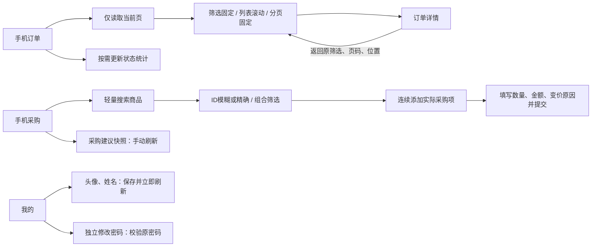

# 手机工作台性能与个人资料优化

开发基线：origin/release/2026.10.21-task-brand 的 f943855，独立分支 codex/mobile-performance-profile。用户授权本轮全部完成并验证后合并 release、部署 ECS；合并和部署前必须再次核对其他窗口与实际线上提交。

## 问题和改动

1. 手机订单首次请求 includeCounts=1，会等待整套库存覆盖及状态统计。列表现在只请求当前页（includeCounts=0，includeLogisticsOptions=0）；状态数量由「更新统计」按需独立读取，统计未返回不遮挡列表或阻止翻页。照片使用浏览器懒加载；离开页面和切换查询会取消旧请求，迟到的旧账号结果不能回填。
2. 手机采购原先默认进入必须采购并持续轮询需求快照，导致用户登记实际采购也面对核算等待。现在默认是轻量商品搜索；「查询、刷新、登记采购」位于同一行，空白采购表始终可开。必须采购和保障补货仍保留为标签，读取现有快照、手动刷新，不再启动反复轮询。未核算数量显示未知，不补成0，不猜采购件数。
3. 「我的」空白来自 roleLabels 已返回文字却被再次调用 join。改为正确渲染，并提供头像预览、姓名保存和独立修改密码表单。复用 PUT /api/auth/profile、POST /api/auth/change-password。资料成功后立即更新当前用户及本机缓存，跨账号迟到响应丢弃；错误不清空输入；密码成功后清空密码框，保留现有后端密码强度及其他设备会话撤销规则。
4. 头像由手机本地裁为160×160 JPEG并限制在24000字符以内，经原个人资料接口保存。无需给仓库增加上架素材权限，也不调用OSS上传或AI。姓名为显示姓名，登录用户名仍只读。
5. 首页只保留按权限的经营指标、日期和刷新；移除底部功能卡和长篇说明。卡片统一两列、对齐金额，重点营业额与利润突出，金额过长不撑宽页面。未更改金额算法或财务权限。
6. 订单、商品库存、采购及核验收货均采用顶部筛选、中央列表滚动、底部分页三个区域。共用 MobilePagination，显示记录数、当前页/总页数，支持跳页和20/50/100条，默认20条；不是把全部记录拉回再分页。
7. 商品库存、采购列表和采购表统一使用 MobileInventorySearch 和原 InventoryStructuredSearch。综合模式沿用商品库存模糊搜索，inventory_id/sku模式精确匹配；核心品名、品牌、车型、颜色、款式、材质、工艺、产品名称均发送原共享筛选字段。结果有图片、编码和类型，可连续添加；已知单品不再请求一次组成，套装仍须读取并展开真实子产品。
8. 除首页外统一显示返回按钮。优先回手机端上一页，没有可用手机历史时回首页，避免意外退出ERP。订单列表页码和每页条数保存在路由；进入详情前记录滚动位置，返回后恢复。采购表另有返回按钮，未提交内容需要确认放弃，选择继续填写会保留。
9. 采购只登记实际采购，不提供本地实物盘点；更新实物继续位于库存模块。未修改采购/库存公共计算、企业隔离、冻结利润或生产数据。

## 交互流程



## 本地验证证据

- 84项相关单元、真实SFC执行/SSR、身份缓存及旧采购收货回归通过，0失败、0跳过。包括「我的」真实渲染、行数据不等待统计、统计中仍可翻页、采购默认不核算、不重复轮询、跨账号响应丢弃、返回安全边界。
- 独立MySQL共34项通过，0失败。另有1项历史库存搜索测试硬编码Linux socket，在macOS跳过，未算作通过；本轮未修改该搜索实现。
- 浏览器使用真实Vue组件与可控本地接口：375/390/430像素无横向溢出；列表滚动前后固定区位移为0；100条分页正常，底部分页不被导航遮住。核验收货嵌套列表同样验证。
- 浏览器通过：采购ID模糊/精确参数、组合筛选及连续添加；单品不额外请求组成；采购返回时确认放弃/继续；订单详情返回恢复第2页和滚动位置300；资料失败保留、头像JPEG预览、成功后顶部姓名刷新、错误密码提示及成功后清空密码；首页不再显示功能卡。
- 以上不冒充iPhone/Android真机或生产业务验收。生产验收仅读取接口及资源，不在生产试改密码、头像、采购或库存。

复验：

```sh
DB_HOST=127.0.0.1 DB_NAME=unused_test DB_USER=root node --test test/mobile-performance-profile.test.js test/mobile-workbench.test.js test/mobile-install.test.js test/mobile-responsive-shell.test.js test/frontend-auth-store-isolation.test.js test/frontend-auth-cache-isolation.test.js test/auth-session.test.js test/auth-security.test.js test/order-receipt-button.test.js test/order-procurement-receipt-quantity.test.js test/inventory-workflow-completion.test.js
npm run check:encoding
npm run check:sql-bindings
npm run docs:api:check
npm run build:frontend
```


## 2026-11-02 并行 release 合并复验

发布前同步到 b28006b，保留订单查询与后台任务调度优化、规范静态资源入口及库存占用页面。手机首页库存金额可进入占用明细，库存页保留占用入口。订单列表继续使用当前页先显示、统计按需独立刷新；将旧首屏测试迁移为实际 Vue 组件测试，验证统计失败不影响翻页。85 项回归、前端构建、UTF-8、SQL 参数及 API 文档检查通过。
