# 库存流转设计稿

> 2026-10-29，爆单 ERP / Ozon ERP。供业务确认、开发实现及换电脑继续开发使用。
> 本文是持续维护的设计与实现交接稿。实际代码以最新远端 release 为准；本地测试、代码合并、ECS 部署和真实客户验收是四个不同状态。

## 1. 总流程：围绕同一个库存商品

商品库存是父概念，本地实物与官方 FBP 库存分别核算。所有入口复用同一库存详情和计算政策；专业工作台保留批量、财务及历史处理能力。

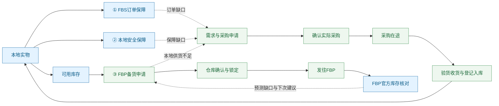

实线表示业务供给或库存状态变化；虚线表示需求反馈。图中阶段数量不能全部相加：在途、申请、锁定、官方实物是不同状态或不同库存池。

- 本地实物：当前真实在仓数量，结合原库存流水和盘点核对。
- FBS 订单保障：已出单、仍需本地履约的实际需求，优先级最高。
- 本地安全保障：未来本地 FBS 消耗的保障目标，不含已经出单数量，不生成出库流水。
- 可用库存：本地实物减实际订单需求、未来安全保障、已经确认的 FBP 占用，最低展示 0；缺口另外呈现。
- FBP 申请：提交前只是草稿／机会；仓库确认后锁定确认数量，实际发运才扣实物。
- FBP 官方库存：按店铺与 SKU 拉取已保存的 Ozon 快照后折算，不因查看明细重复扣订单，也不加到本地可用里。

## 2. 数量、单位和优先级

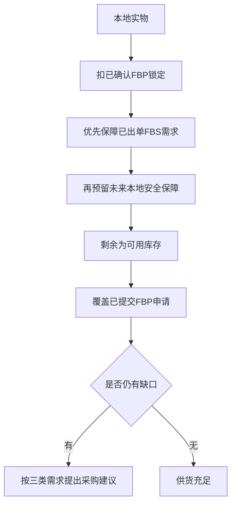

业务优先级是：FBS 实际订单 → 本地安全保障 → FBP 已提交申请。已有确认锁定属于已承诺库存，不因后续需求变化被静默挪用；出现冲突必须提示并由有权限人员处理。

计算口径：

```text
可用库存 = max(0, 本地实物 − FBS实际订单需求 − 本地安全保障 − 已确认FBP占用)
FBS保障天数 = max(生产周期＋到本地周期, 7天)，再计入整体停工日期
本地安全保障 = ceil(近7个完整北京时间自然日的本地实物消耗 ÷ 7 × FBS保障天数)
FBP保障天数 = max(生产周期＋到本地周期＋本地到FBP周期, 15天)，再计入整体停工日期
SKU目标备货套数 = ceil(SKU日均销量 × FBP保障天数)
按起订倍数的实际采购件数 = ceil(建议件数 ÷ 起订倍数) × 起订倍数
```

- `ceil` 向上取整到一个整数件／套，不是默认取整为十件、二十件。
- FBP 建议每 SKU 至少 5 套，可人工调整；不强制每次都是 5 的倍数。
- “1 份库存”可能本身就是 4 件包装。套装拆分按绑定的库存单位与用量转换，不能把商品标题的“8 件套”直接当 8 份库存。
- 本地消耗优先使用实际发运证据和冻结出库组成；待发订单、FBP 消耗不作为本地过去七天消耗。历史缺少发运日期时按既有规则估计，并在明细提示。
- 已分配在途只影响未来采购缺口，不增加可立即发货的现货。预计到货时间未知或逾期时需要人工核对，不能承诺本次及时交付。
- 设置、日期缺失或实物为负时显示待核对，不能用零伪装已计算完成。

### 2.1 已确认示例

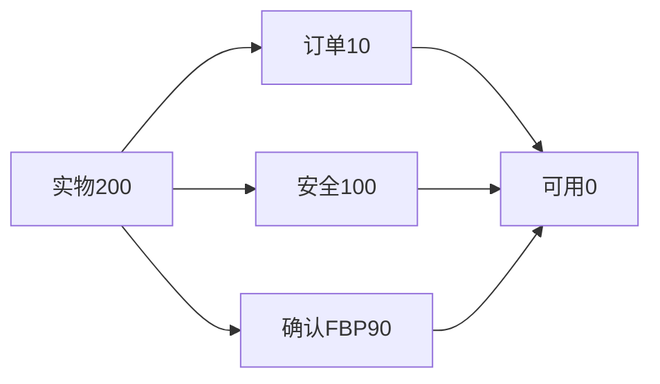

安全库存 100 不包含订单 10。不能预留两遍订单，也不能将未确认申请再减一次。

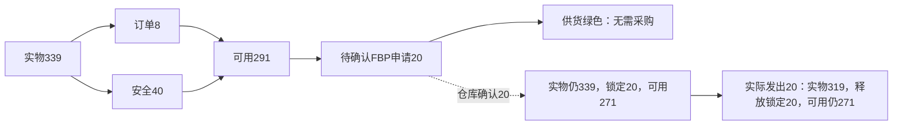

## 3. 颜色：供货与业务进度分开

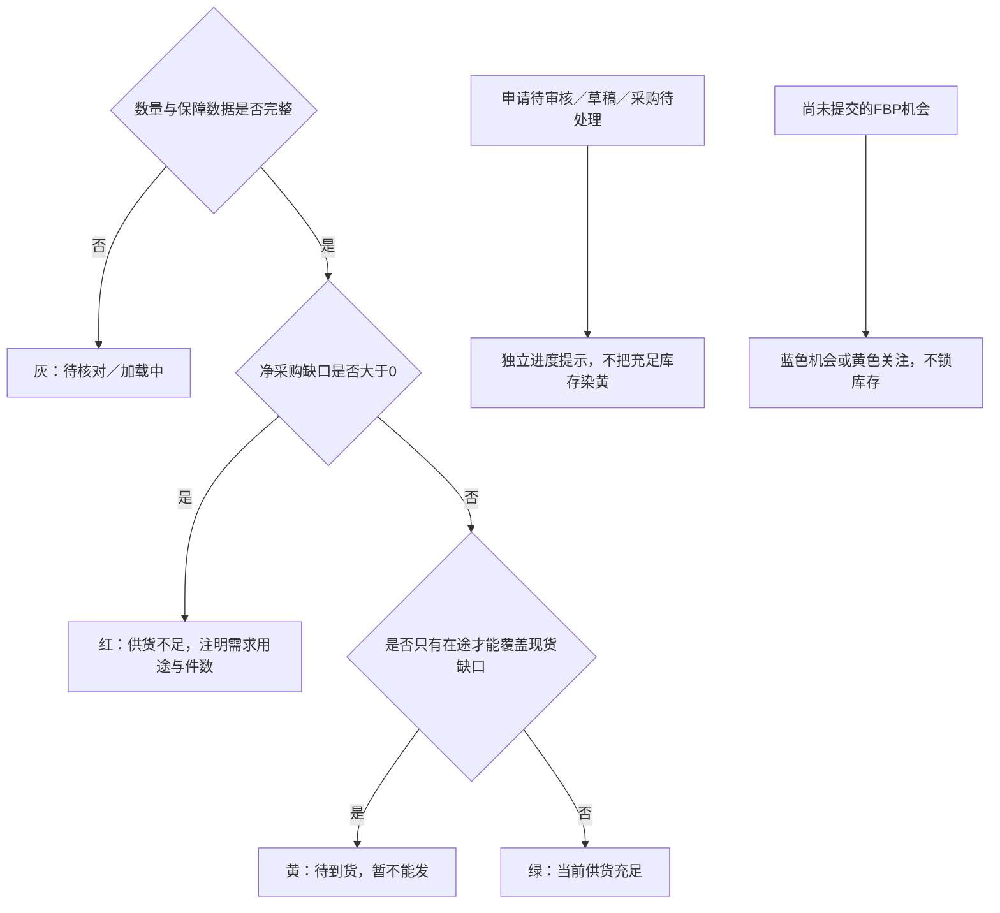

一个 FBP 申请等待仓库确认，不等于库存不足。可用 291 件足以覆盖申请 20 件时，供货为绿；“待仓库确认”可以单独标黄。历史申请、已发运记录、草稿、建议与正式缺口不能混为一谈。

## 4. 采购：只有三类需求

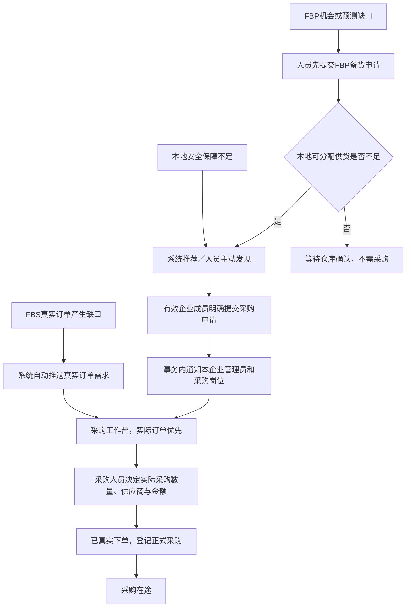

- 三类用途键：`real_order`、`local_safety`、`fbp_stock`。仓库、运营、系统是来源，不是第四种需求类型。
- 推荐不等于申请，申请不等于已采购，已采购不等于到货。
- 同一商品同一用途的多人提醒不能相加成多倍缺口；实际订单与正式 FBP 申请按真实需求计算。
- 申请带提出人、用途、件数、说明和来源订单；不伪造订单分配，不自动改实物。
- 申请与站内通知原子提交；通知失败一起回滚。相同 UUID 重试不新增，改内容必须使用新提交标识。
- 从明细登记实际采购时承接已有申请，沿用现有确认、金额、价格异常和部分覆盖规则，不另建重复需求。
- 采购导出名称为“导出采购记录”；点击后选择北京时间范围，不把导出日期混作列表查询条件。
- 保留既有历史申请及采购记录，不因新规则批量删除、重跑历史清理或重算成本利润。

## 5. 收货、验货与实物入库

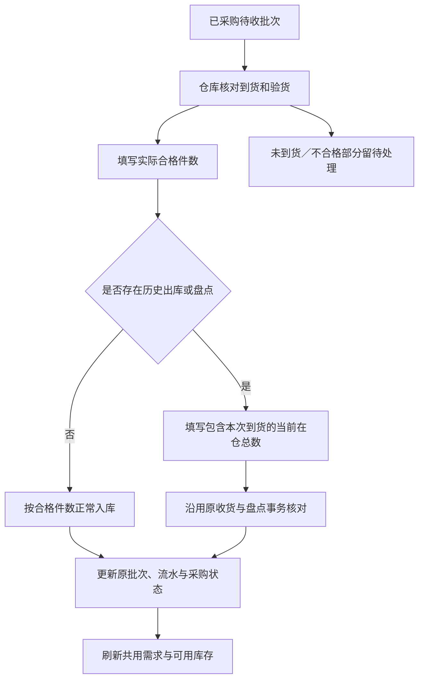

例如待收 10 件，本次合格 6 件：只入库 6 件，余 4 件继续待处理，部分收货须说明原因。有历史盘点时不能简单在已盘点实物上再加一次历史到货。重复、过量、过时批次版本须拒绝或按原幂等机制核对。

仓库只获得限定收货路径，不因此获得采购付款、历史财务改动或通用盘点权限。采购、管理员与仓库岗位按当前企业成员授权重新核实。

## 6. FBP 周期、申请版本与更正

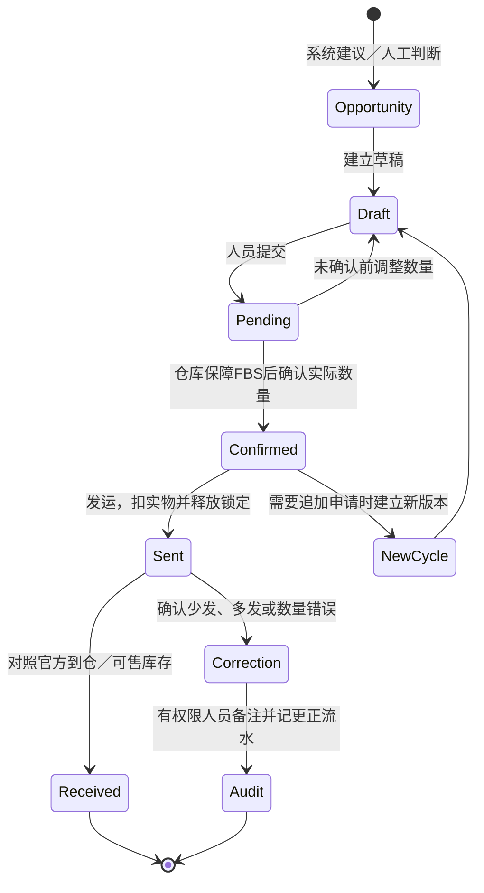

- 一周／两周备货仅为例子，不固定死发运日。生产、本地运输、到 FBP 的周期可配置；本地到 FBP 默认 7 天。
- 假期影响整体周期，不分别重复加到各环节；自定义停工日期范围取并集。春节等日期不写死每年不变。
- 仓库可以将申请 300 件中的 90 件确认为本周期数量并发出；其余不自动滚入下一份申请，不自动触发购买 210 件。
- 仓库确认后，该申请数量版本冻结；新增需求另开版本。采购建议和本次发仓任务相互独立。
- 已发运发现实际仅发 25、原记 30 时，确认后用有原因的更正记录恢复本地 5 件，保留原记录与审计。不能直接覆盖历史流水或伪装官方库存。
- 官方 FBP 数量由 Ozon 同步；一份本地库存可能对应多店铺、多 SKU，要全部按有效组成折算。店铺失败保留旧快照并标不完整，不能以部分成功冒充全部核实。

## 7. SKU、套装与配方：为什么同一库存会看到不同商品

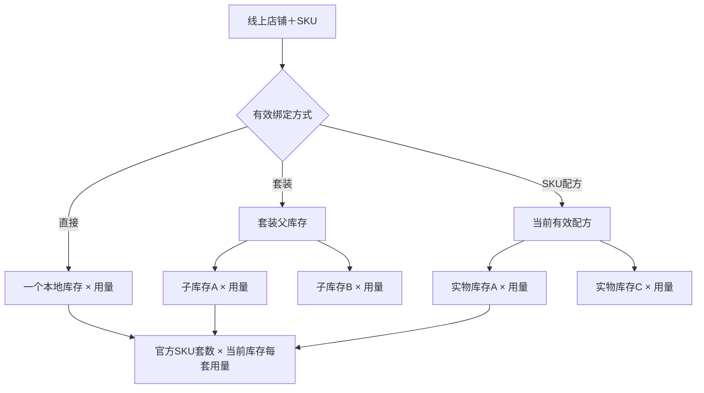

只在 FBP 明细展开后显示 SKU 图片；再展开组成，读取完整的当前绑定／套装／配方。展示店铺、SKU、线上规格、父库存、子库存编号、名称、每套用量，并高亮当前查看库存。未查看不加载组成；同一明细反复展开可复用，切换商品、企业或账号须清除。

已只读核对的例子：SKU `4655568581` 直接绑定父库存 `3-9`；父库存组成中有不锈钢门槛条 `2-2 × 1` 与贴纸 `3-1 × 1`。所以会出现在 `3-1` 的 FBP 汇总中。138 套代表包含 138 份该库存单位，不是把 SKU 直接绑为贴纸。

该例线上规格 T4/T4L 与父库存名称 T7/T8 不一致，仍须结合实物和原建品资料人工核对。仅凭名称不自动解绑或修改历史订单，当前没有执行生产绑定修复。

## 8. FBP 分级与建议

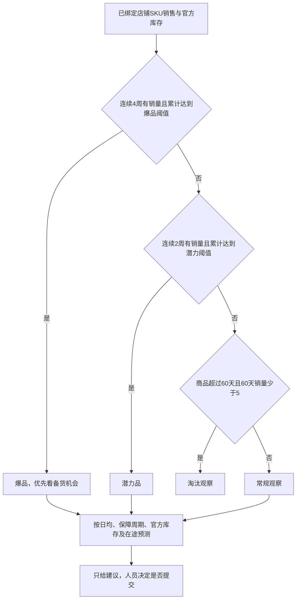

当前共用预测默认潜力累计 20、爆品累计 100，可配置；每周是否有销量也要满足。预测、实际申请、仓库锁定是不同数据。专业机会工作台的排序与批量操作保留，创建／核对时以共用详情的周期、分级和实际供货为准，不把分数自动变成采购义务。

## 9. 本地订单履约与异常

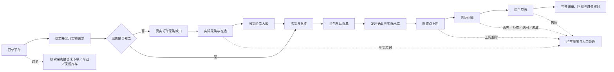

ERP 按订单已经确认的发货方式处理。当前本地 FBS 包含 CEL、邮政、国欧、OGL 等渠道；OGR 作为后续方式预留，不在本轮实现供货调度，也不自动修改 Ozon 的 FBS 虚拟可售库存。拒收、退货、取消和出库更正继续沿用已有业务证据和审计，不因展示变化自动重算旧利润。

## 10. 页面组织与加载分层

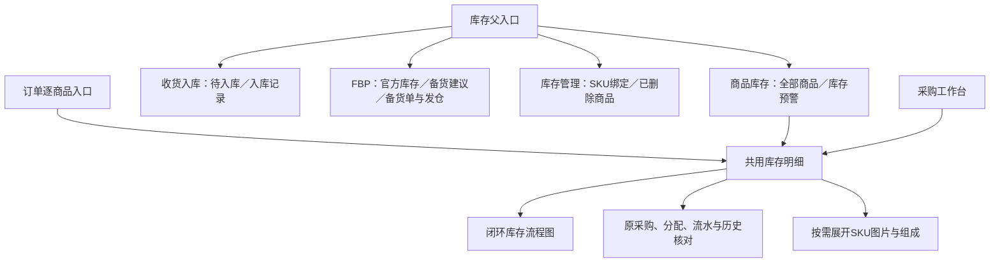

商品库存保留名称、库存编号、图片、本地／FBP／可用数量、销售、采购成本、历史出库、库存货值。利润与在途列退出该列表；底层记录和专业页面不删除。“库存货值”是数量与采购成本的估算金额，不是冻结库存件数。常驻操作为编辑、更新本地库存、库存明细；其余归入更多。顶部保留结构化精确搜索，收窄搜索方式、店铺、日期和类型；删除维护说明标题。

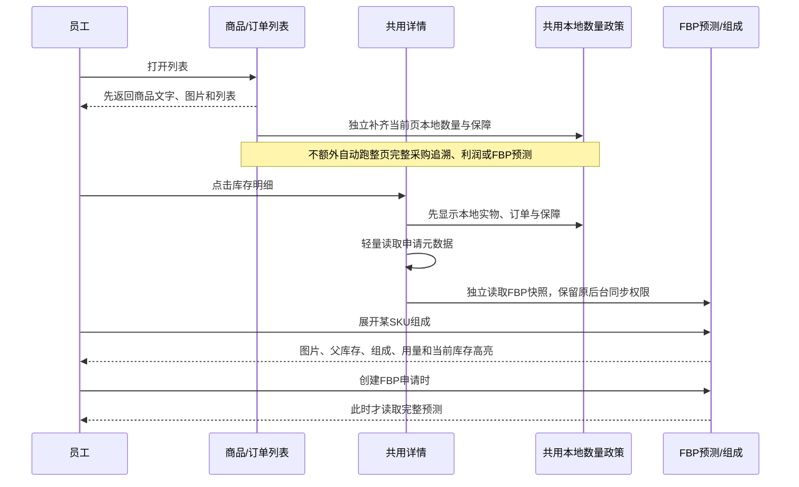

列表首屏不等待库存核算；数量未完成时明确待核对，不以零填充。精简本地读取仍使用同一订单发运证据、冻结组成和安全保障计算；只省去此次不需要的采购分配、历史来源、财务字段等查询，不另写一套可用数公式。虚拟套装可用套数由子库存可用数量除每套用量后取最小整数。官方 FBP 汇总复用同一有效绑定与折算器。

## 11. 权限与安全

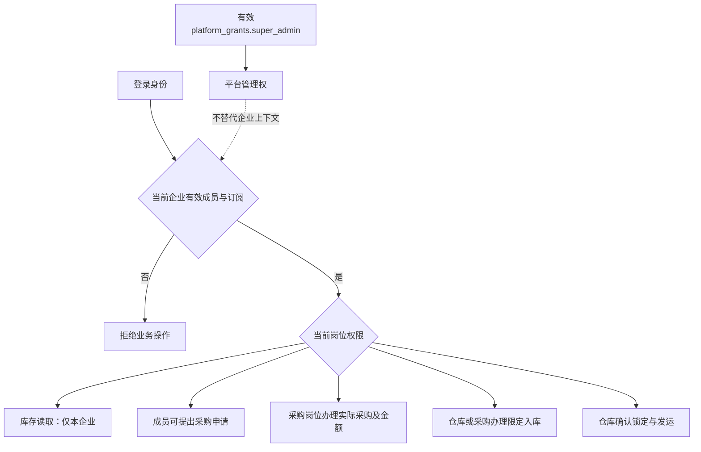

用户名、`people.role`、企业负责人身份均不能推断平台超级管理员。所有写入重新校验当前企业、成员和岗位；缓存按企业、商品与身份范围隔离。照片、配置、验证文件、密钥不进 Git。不开生产自动硬删，不重跑历史清理，不修改冻结 V1，不重置历史汇率边界。

## 12. 开发交接与验证要求

主要代码入口（相对仓库根目录）：

- `src/shared/inventory-workflow.js`：三类供货政策、独立业务进度与颜色。
- `src/services/inventory-workflow.js`：共用读取、轻量申请元数据、SKU组成、申请与收货。
- `src/services/inventory-flow-summary-model.js`：本地实际消耗与安全保障。
- `src/services/mysql-order-procurement-coverage.js`：订单需求、发运证据、冻结实物组成；精简本地读取不能改变这些依据。
- `src/services/fbp-inventory-display.js`：多店铺SKU快照和套装／配方折算；批量与单商品复用。
- `frontend/admin/components/procurement/ProcurementLedgerDialog.vue`：所有入口复用的详情。
- `InventoryFlowDiagram.vue`、`InventoryWorkflowPanel.vue`、`InventoryFbpSkuTable.vue`：闭环图、操作、按需SKU明细。
- `frontend/admin/views/inventory/InventoryProductsPage.vue`：精简商品库存。
- `src/server/api-docs.js` 与 `docs/BACKEND_API_REFERENCE.md`：接口契约，修改后同步生成。

继续开发前：读仓库及父目录 AGENTS.md，fetch 远端，识别当前 release。从其最新提交开 `codex/…` 分支；保留其他窗口和未提交内容。当前惯用 release 为 `release/2026.10.21-task-brand`，但必须再次核对。

环境：Node.js 22、MySQL 8、按 lock 安装。仅用独立本地测试库与 8788，`SCHEDULED_JOBS_ENABLED=false`。凭据只在本机私密配置中，不能复制旧电脑用户名路径进代码，不能重新生成生产加密密钥。

重点验收：

1. 339／8／40／20 场景供货绿、进度黄分开；确认及发运后可用数量连续一致。
2. 精简列表与完整详情在直接商品、套装、配方、锁定、已发运、历史冻结组成下口径相同。
3. 列表不触发额外整页工作流扫描；明细不提前加载完整预测；SKU组成只在展开时加载，身份切换无旧资料回流。
4. 申请与通知幂等，部分收货不多加库存，仓库不会因此获得通用财务权限。
5. 1920／1366 深浅色、手机布局，所有节点可悬浮和打开明细，低频操作可在更多找到。
6. 编码、SQL参数、构建、API文档，以及企业A/B和现有采购/发运回归。

发布必须从合并后的干净 release 精确提交构建。合并前、部署前再次 fetch；并行改动使用三方合并，不拿旧版整文件覆盖。按现有 ECS 候选预热、就绪、切换与回滚流程执行。汇报分别给出本地验证、合并 SHA、ECS 版本与真实业务验收状态。
