# 库存流转设计稿

> 2026-10-29，爆单 ERP / Ozon ERP。供业务确认、开发实现及换电脑继续开发使用。
> 本文是持续维护的设计与实现交接稿。实际代码以最新远端 release 为准；本地测试、代码合并、ECS 部署和真实客户验收是四个不同状态。

## 2026-10-31 补充：空表批量采购与需求一致性核查

- “批量登记采购”不要求预先勾选库存：无勾选直接打开空表，搜索后逐项加入；有勾选先带入所选，仍可搜索追加。复用同一批量采购组件，不建立另一套采购写入。空表禁止提交，追加库存去重，保留原100项上限、真实货款校验、企业范围和幂等提交。
- 对账必须以同企业、同库存、相近核算时点的真实FBS订单未覆盖量比较，不能把旧页全部采购建议（含本地保障、FBP及人工申请）直接等同于“必须采购”。申请数与现货/采购在途抵扣后的净缺口应分别展示；已有在途覆盖的申请不应重复采购。
- 负账面库存的真实订单仍须显式列出待核需求，不得因为采购数量未知而从列表过滤，也不能将未知当零或直接把账面缺口当成已确认采购量。必须先核实实物，再确定实际采购数量。本节记录核查发现及应遵循的规则；历史负账面未自动清零，旧工作台过滤/口径差异仍需后续统一处理。


## 1. 总流程：围绕同一个库存商品

商品库存是父概念，本地实物与官方 FBP 库存分别核算。所有入口复用同一库存详情和计算政策；专业工作台保留批量、财务及历史处理能力。

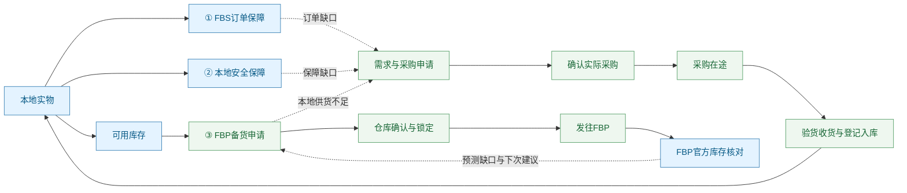

实线表示业务供给或库存状态变化；虚线表示需求反馈。图中阶段数量不能全部相加：在途、申请、锁定、官方实物是不同状态或不同库存池。

- 本地实物：当前真实在仓数量，结合原库存流水和盘点核对。
- FBS 订单保障：已出单、仍需本地履约的实际需求，优先级最高。
- 本地安全保障：未来本地 FBS 消耗的保障目标，不含已经出单数量，不生成出库流水。
- 可用库存：本地实物减实际订单需求、未来安全保障、已经确认的 FBP 占用，最低展示 0；缺口另外呈现。
- FBP 申请：提交前只是草稿／机会；仓库确认后锁定确认数量，实际发运才扣实物。
- FBP 官方库存：按店铺与 SKU 拉取已保存的 Ozon 快照后折算，不因查看明细重复扣订单，也不加到本地可用里。

## 2. 数量、单位和优先级

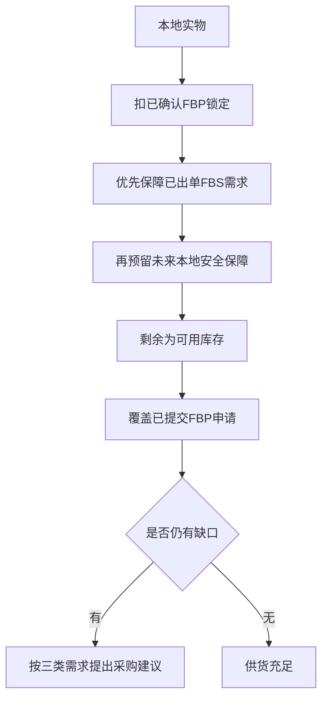

业务优先级是：FBS 实际订单 → 本地安全保障 → FBP 已提交申请。已有确认锁定属于已承诺库存，不因后续需求变化被静默挪用；出现冲突必须提示并由有权限人员处理。

计算口径：

```text
可用库存 = max(0, 本地实物 − FBS实际订单需求 − 本地安全保障 − 已确认FBP占用)
FBS保障天数 = max(生产周期＋到本地周期, 7天)，再计入整体停工日期
本地安全保障 = ceil(近7个完整北京时间自然日的本地实物消耗 ÷ 7 × FBS保障天数)
FBP保障天数 = max(生产周期＋到本地周期＋本地到FBP周期, 15天)，再计入整体停工日期
SKU目标备货套数 = ceil(SKU日均销量 × FBP保障天数)
按起订倍数的实际采购件数 = ceil(建议件数 ÷ 起订倍数) × 起订倍数
```

- `ceil` 向上取整到一个整数件／套，不是默认取整为十件、二十件。
- FBP 建议每 SKU 至少 5 套，可人工调整；不强制每次都是 5 的倍数。
- “1 份库存”可能本身就是 4 件包装。套装拆分按绑定的库存单位与用量转换，不能把商品标题的“8 件套”直接当 8 份库存。
- 本地消耗优先使用实际发运证据和冻结出库组成；待发订单、FBP 消耗不作为本地过去七天消耗。历史缺少发运日期时按既有规则估计，并在明细提示。
- 已分配在途只影响未来采购缺口，不增加可立即发货的现货。预计到货时间未知或逾期时需要人工核对，不能承诺本次及时交付。
- 设置、日期缺失或实物为负时显示待核对，不能用零伪装已计算完成。

### 2.1 已确认示例

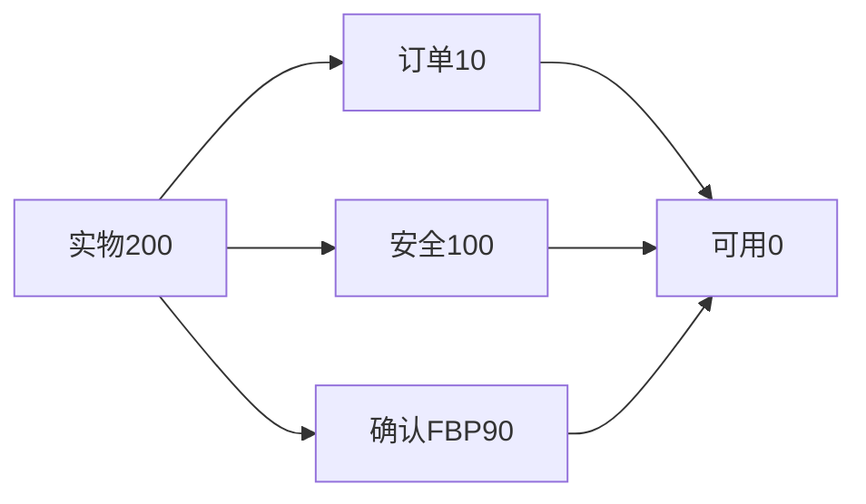

安全库存 100 不包含订单 10。不能预留两遍订单，也不能将未确认申请再减一次。

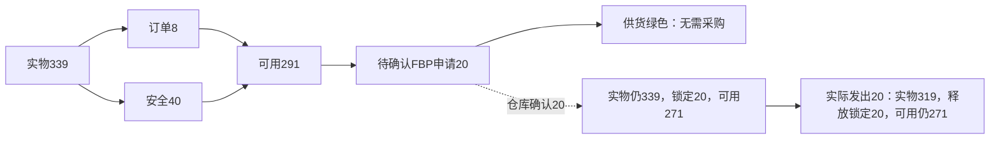

## 3. 颜色：供货与业务进度分开

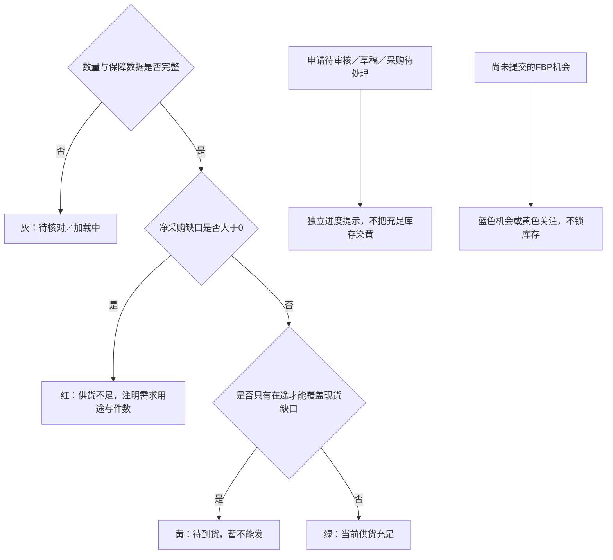

一个 FBP 申请等待仓库确认，不等于库存不足。可用 291 件足以覆盖申请 20 件时，供货为绿；“待仓库确认”可以单独标黄。历史申请、已发运记录、草稿、建议与正式缺口不能混为一谈。

## 4. 采购：只有三类需求

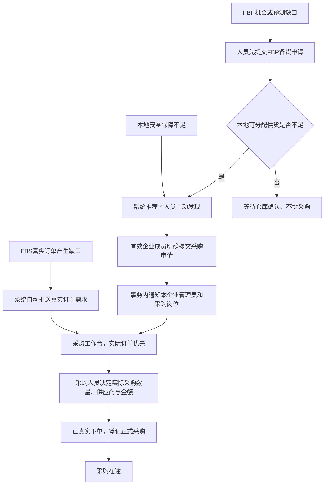

- 三类用途键：`real_order`、`local_safety`、`fbp_stock`。仓库、运营、系统是来源，不是第四种需求类型。
- 推荐不等于申请，申请不等于已采购，已采购不等于到货。
- 同一商品同一用途的多人提醒不能相加成多倍缺口；实际订单与正式 FBP 申请按真实需求计算。
- 申请带提出人、用途、件数、说明和来源订单；不伪造订单分配，不自动改实物。
- 申请与站内通知原子提交；通知失败一起回滚。相同 UUID 重试不新增，改内容必须使用新提交标识。
- 从明细登记实际采购时承接已有申请，沿用现有确认、金额、价格异常和部分覆盖规则，不另建重复需求。
- 采购导出名称为“导出采购记录”；点击后选择北京时间范围，不把导出日期混作列表查询条件。
- 保留既有历史申请及采购记录，不因新规则批量删除、重跑历史清理或重算成本利润。

## 5. 收货、验货与实物入库

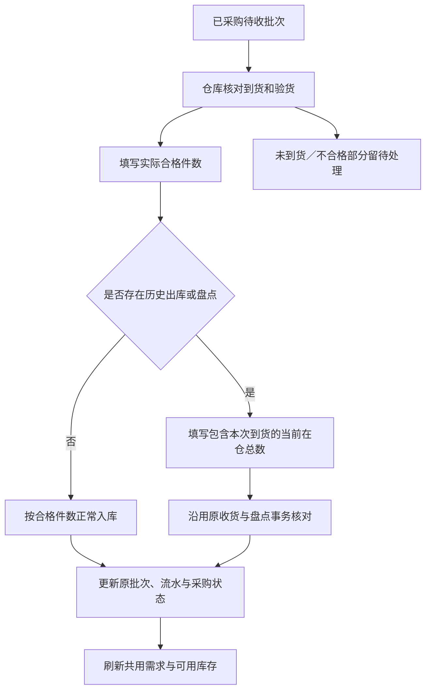

例如待收 10 件，本次合格 6 件：只入库 6 件，余 4 件继续待处理，部分收货须说明原因。有历史盘点时不能简单在已盘点实物上再加一次历史到货。重复、过量、过时批次版本须拒绝或按原幂等机制核对。

仓库只获得限定收货路径，不因此获得采购付款、历史财务改动或通用盘点权限。采购、管理员与仓库岗位按当前企业成员授权重新核实。

## 6. FBP 周期、申请版本与更正

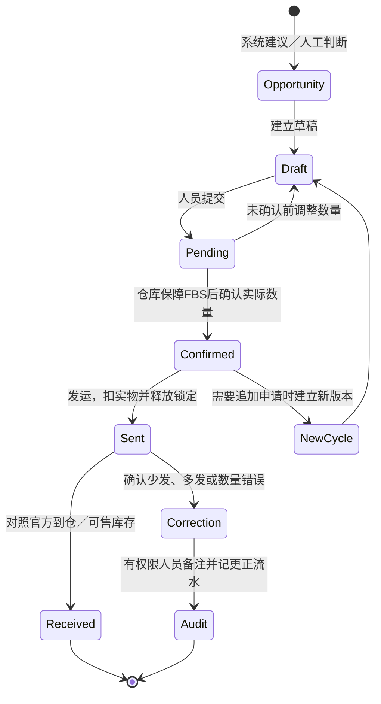

- 一周／两周备货仅为例子，不固定死发运日。生产、本地运输、到 FBP 的周期可配置；本地到 FBP 默认 7 天。
- 假期影响整体周期，不分别重复加到各环节；自定义停工日期范围取并集。春节等日期不写死每年不变。
- 仓库可以将申请 300 件中的 90 件确认为本周期数量并发出；其余不自动滚入下一份申请，不自动触发购买 210 件。
- 仓库确认后，该申请数量版本冻结；新增需求另开版本。采购建议和本次发仓任务相互独立。
- 已发运发现实际仅发 25、原记 30 时，确认后用有原因的更正记录恢复本地 5 件，保留原记录与审计。不能直接覆盖历史流水或伪装官方库存。
- 官方 FBP 数量由 Ozon 同步；一份本地库存可能对应多店铺、多 SKU，要全部按有效组成折算。店铺失败保留旧快照并标不完整，不能以部分成功冒充全部核实。

## 7. SKU、套装与配方：为什么同一库存会看到不同商品

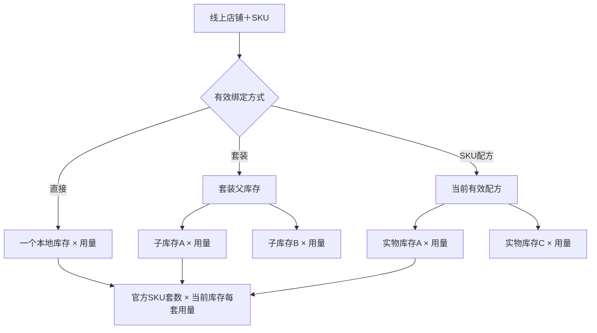

只在 FBP 明细展开后显示 SKU 图片；再展开组成，读取完整的当前绑定／套装／配方。展示店铺、SKU、线上规格、父库存、子库存编号、名称、每套用量，并高亮当前查看库存。未查看不加载组成；同一明细反复展开可复用，切换商品、企业或账号须清除。

已只读核对的例子：SKU `4655568581` 直接绑定父库存 `3-9`；父库存组成中有不锈钢门槛条 `2-2 × 1` 与贴纸 `3-1 × 1`。所以会出现在 `3-1` 的 FBP 汇总中。138 套代表包含 138 份该库存单位，不是把 SKU 直接绑为贴纸。

该例线上规格 T4/T4L 与父库存名称 T7/T8 不一致，仍须结合实物和原建品资料人工核对。仅凭名称不自动解绑或修改历史订单，当前没有执行生产绑定修复。

## 8. FBP 分级与建议

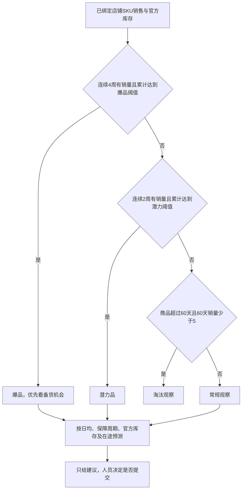

当前共用预测默认潜力累计 20、爆品累计 100，可配置；每周是否有销量也要满足。预测、实际申请、仓库锁定是不同数据。专业机会工作台的排序与批量操作保留，创建／核对时以共用详情的周期、分级和实际供货为准，不把分数自动变成采购义务。

## 9. 本地订单履约与异常

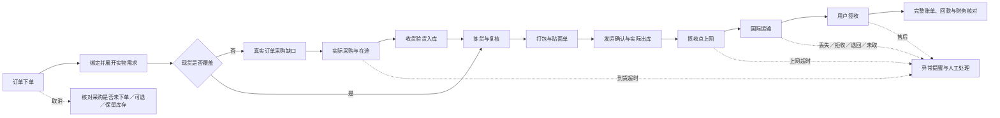

ERP 按订单已经确认的发货方式处理。当前本地 FBS 包含 CEL、邮政、国欧、OGL 等渠道；OGR 作为后续方式预留，不在本轮实现供货调度，也不自动修改 Ozon 的 FBS 虚拟可售库存。拒收、退货、取消和出库更正继续沿用已有业务证据和审计，不因展示变化自动重算旧利润。

## 10. 页面组织与加载分层

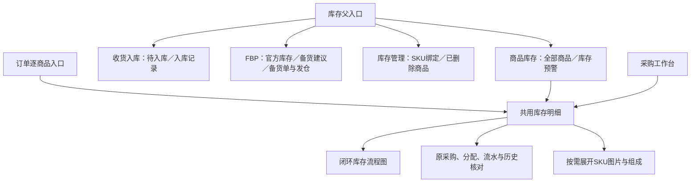

商品库存保留名称、库存编号、图片、本地／FBP／可用数量、销售、采购成本、历史出库、库存货值。利润与在途列退出该列表；底层记录和专业页面不删除。“库存货值”是数量与采购成本的估算金额，不是冻结库存件数。常驻操作为编辑、更新本地库存、库存明细；其余归入更多。顶部保留结构化精确搜索，收窄搜索方式、店铺、日期和类型；删除维护说明标题。

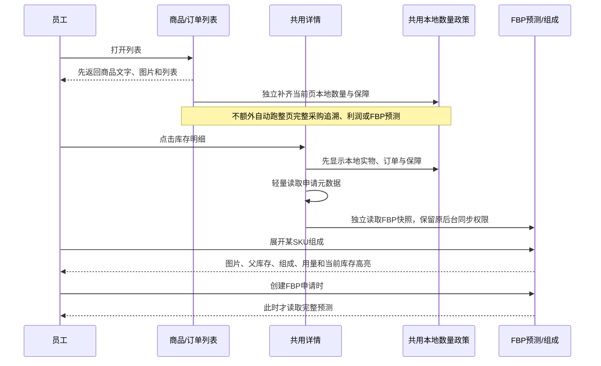

列表首屏不等待库存核算；数量未完成时明确待核对，不以零填充。精简本地读取仍使用同一订单发运证据、冻结组成和安全保障计算；只省去此次不需要的采购分配、历史来源、财务字段等查询，不另写一套可用数公式。虚拟套装可用套数由子库存可用数量除每套用量后取最小整数。官方 FBP 汇总复用同一有效绑定与折算器。

## 11. 权限与安全

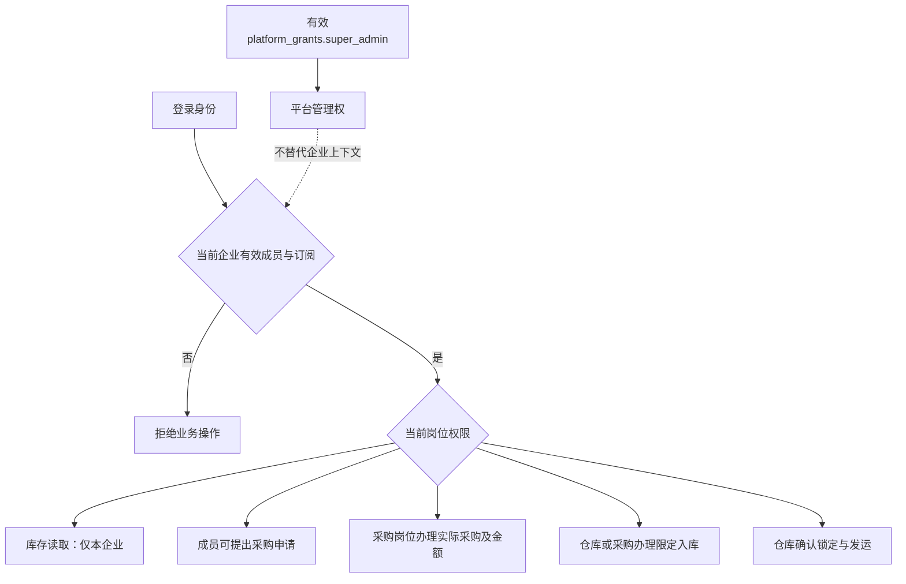

用户名、`people.role`、企业负责人身份均不能推断平台超级管理员。所有写入重新校验当前企业、成员和岗位；缓存按企业、商品与身份范围隔离。照片、配置、验证文件、密钥不进 Git。不开生产自动硬删，不重跑历史清理，不修改冻结 V1，不重置历史汇率边界。

## 12. 开发交接与验证要求

主要代码入口（相对仓库根目录）：

- `src/shared/inventory-workflow.js`：三类供货政策、独立业务进度与颜色。
- `src/services/inventory-workflow.js`：共用读取、轻量申请元数据、SKU组成、申请与收货。
- `src/services/inventory-flow-summary-model.js`：本地实际消耗与安全保障。
- `src/services/mysql-order-procurement-coverage.js`：订单需求、发运证据、冻结实物组成；精简本地读取不能改变这些依据。
- `src/services/fbp-inventory-display.js`：多店铺SKU快照和套装／配方折算；批量与单商品复用。
- `frontend/admin/components/procurement/ProcurementLedgerDialog.vue`：所有入口复用的详情。
- `InventoryFlowDiagram.vue`、`InventoryWorkflowPanel.vue`、`InventoryFbpSkuTable.vue`：闭环图、操作、按需SKU明细。
- `frontend/admin/views/inventory/InventoryProductsPage.vue`：精简商品库存。
- `src/server/api-docs.js` 与 `docs/BACKEND_API_REFERENCE.md`：接口契约，修改后同步生成。

继续开发前：读仓库及父目录 AGENTS.md，fetch 远端，识别当前 release。从其最新提交开 `codex/…` 分支；保留其他窗口和未提交内容。当前惯用 release 为 `release/2026.10.21-task-brand`，但必须再次核对。

环境：Node.js 22、MySQL 8、按 lock 安装。仅用独立本地测试库与 8788，`SCHEDULED_JOBS_ENABLED=false`。凭据只在本机私密配置中，不能复制旧电脑用户名路径进代码，不能重新生成生产加密密钥。

重点验收：

1. 339／8／40／20 场景供货绿、进度黄分开；确认及发运后可用数量连续一致。
2. 精简列表与完整详情在直接商品、套装、配方、锁定、已发运、历史冻结组成下口径相同。
3. 列表不触发额外整页工作流扫描；明细不提前加载完整预测；SKU组成只在展开时加载，身份切换无旧资料回流。
4. 申请与通知幂等，部分收货不多加库存，仓库不会因此获得通用财务权限。
5. 1920／1366 深浅色、手机布局，所有节点可悬浮和打开明细，低频操作可在更多找到。
6. 编码、SQL参数、构建、API文档，以及企业A/B和现有采购/发运回归。

发布必须从合并后的干净 release 精确提交构建。合并前、部署前再次 fetch；并行改动使用三方合并，不拿旧版整文件覆盖。按现有 ECS 候选预热、就绪、切换与回滚流程执行。汇报分别给出本地验证、合并 SHA、ECS 版本与真实业务验收状态。


## 2026-10-30 库存统一搜索交互

商品库存、库存预警、FBP 库存、备货建议、FBP 备货单、SKU 绑定和隐藏商品共用搜索组件与产品筛选口径。供应商搜索继续使用供应商字段，不展示与供应商无关的车型属性。

- 基础条件顺序：搜索方式、搜索内容、店铺、该页面确有意义的时间／业务状态；查询、重置固定在同一操作区，业务按钮接在后面。
- 产品搜索直接展示核心品名、汽车品牌、车型、颜色、款式、材质、工艺、产品名称，不额外折叠；宽屏优先一行，窄屏自动换行。商品库存取消店铺与时间筛选，清除旧链接中残留的对应条件；保留库存类型。新增库存、库存创建申请、提交采购需求等业务操作全部移入“更多”。
- 综合搜索保留各页业务入口，例如备货单号、申请人；库存编号、SKU／货号按完整值精确匹配；名称模式按空格分词，所有词均需命中名称或有效别名。
- 不同属性取交集，多个车型／材质在同字段内取并集。店铺、状态等页面业务条件继续叠加；筛选先于统计总数和分页，不在浏览器只过滤当前页。
- 只在点击查询、回车、重置或分页／明确业务状态操作时读取列表；输入和打开筛选本身不触发列表刷新。属性字典按需读取并复用现有短缓存。
- 时间标签明确业务含义：商品创建时间、绑定时间、商品更新时间；不把导出日期混入查询。没有时间条件的页面不新增无实际含义的日期筛选。
- 所有查询保留当前企业归属、权限和原有库存计算。默认打开不额外查产品筛选表，不计算新的库存、利润或 Ozon 同步。

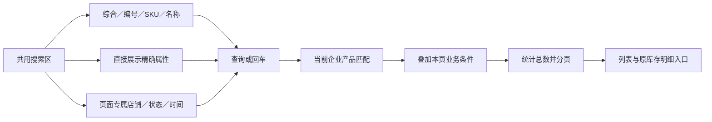

本节记录实现口径；是否合并 release、是否部署 ECS，以本轮交付记录为准。

本轮本地验收：基线已跟进 release `dd6b0a6`（含 PR #27）。28 项定向检查通过，覆盖共同筛选、精确 SKU 不混入同商品其他 SKU、北京时间边界、分页、A/B 企业隔离及原有库存／入库权限。七个页面使用虚拟数据完成浏览器查询交互检查，另检查 1366 深色与 390 手机排版；构建、UTF-8、SQL 绑定和 API 文档检查通过。以上是本地证据，不代表 ECS 已发布或真实员工业务已验收。

2026-10-30 收口：用户已确认合并并部署。商品库存顶部只保留共用产品搜索和库存类型，业务按钮进入“更多”；旧店铺／日期链接条件在页面层清除且不传入请求。桌面宽屏全部条件单行排列，窄屏换行。此处先记录发布前验证口径，实际 release SHA 与 ECS 版本以正式发布结果为准。


## 2026-10-30 收货、FBP 标签与库存表格整理

本轮以最新 release `39d7ba9`（含另一窗口 PR #29）为基线，保留库存联动、供货规划、原始收货/审核/发仓事务。仅整理入口和只读筛选。

- 收货入库只有“待入库”“已入库”两个模块标签。待入库固定读取 `pending_arrival`，已入库固定读取 `approved`，不再叠加“全部/待入库/已入库”状态开关。已入库仍逐笔显示真实入库流水。
- 两页复用商品搜索：搜索方式、内容、库存类型、八项产品属性，额外保留需求类型；待入库保留批量登记到货。采购日期、负责人、供应商、平台等旧隐藏筛选不再进入页面请求。订单跳来的单商品上下文保留，不误当成名称查询。
- 三类需求过滤复用现有业务用途：FBS真实订单、本地安全保障、FBP备货。FBP来源不会因申请单号写在来源订单字段中被误识别成FBS订单。关联采购申请按当前企业过滤，先筛选再统计及分页；旧 `inventory_warning` API 仍兼容。
- FBP 模块标签依次为官方库存、备货建议、待审核、待发货、待入仓、已入仓、已取消、全部。状态写入 URL，同一路由共用同一组件；刷新和前后导航可恢复状态。重置查询不切换当前状态。原单据精确链接仍只查本企业对应记录，归入全部标签。
- 待审核包含草稿/待审核；待发货包含已批准/已创建Ozon记录；待入仓为已发出；已入仓为完成；驳回单仍可从全部中查看。标签不自动提交、锁仓、发货或确认入仓。
- 备货建议顶部保留创建备货单，其余手工添加、PDF导入、同步与推荐筛选放入“更多”。备货单保留库存/运营视角，导出、关联汇总和采购草稿收进“更多”。通用解释性标题移除；精确单据、订单上下文等有操作意义的提示保留。
- 商品库存只展示本地库存和可用库存，完整数字/单位不拆行，FBP数量在官方库存和明细查看。库存明细、编辑、更新本地库存及其他可点击操作使用有边框的按钮；现有权限与确认步骤保持。

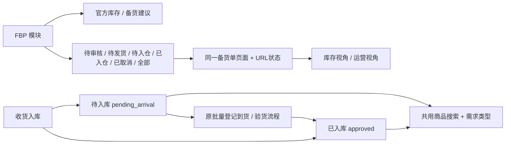

本地验证与生产发布分开记录；本轮未获新的上线确认前，不部署 ECS。

本地验收：57 项定向检查通过，覆盖两个固定入库状态、三类需求、共用产品属性、SKU 精确匹配、分页、企业隔离及原收货事务；构建、UTF-8、SQL绑定与API文档检查通过。只读演示中验证了全部FBP状态标签、重置保留状态、库存/运营视角切换、编辑框与更多菜单。同一商品的两笔采购（5件、7件）可分别选中并进入批量收货框：列表保留入库记录唯一键，不再按商品合并选择。1920宽屏备货建议筛选单行展示，1366宽屏无整页横向溢出；商品库存只显示本地/可用和明细按钮。浏览器验证未提交写入，未连接生产库。提交前另核对到PR #30性能优化并在任务分支纳入，复验结果以本轮交付记录为准。

PR #30 纳入任务分支后复验：69 项定向测试全部通过，前端构建、UTF-8、SQL绑定和API文档检查再次通过。未合并本任务至release，未部署ECS。

## 2026-10-30 紧凑总图与节点工作台

基线 `63a3a01`，保留 PR #32 的需求快照及此前性能修复。此节为本轮设计和本地实现记录，上线状态另见本轮发布记录。

### 展示与入口

- 库存明细仍复用订单、采购、库存各模块的同一组件。默认展示紧凑总图，按窗口剩余高度自动适配比例；保留“原比例／适合窗口”，窄屏可横向查看。连线按实际缩放比例与节点文字边界计算。
- 底部默认不展开流水、历史、采购成本及核对表。顶部“核对记录”按需打开原有表格；图中节点在当前页面打开独立明细。订单入口的本单商品及分配也可手动展开，继续支持多商品切换。
- 首次打开不请求节点记录。点击采购申请、采购记录、在途、验收、FBS订单或本地安全保障后，才读取该节点的数据。节点保存刷新本地明细，不重新触发一次 Ozon 官方同步。
- 本地实物单击复用原盘点表；本地可用库存只展示数量；FBP申请、锁定、在途、入仓及官方SKU继续使用原单据和官方同步数据，不推算可售数。

### 采购、到货与异常

用户已确认：**审批时同时登记实际采购人、数量和金额，提交成功后直接转采购在途**。复用 `confirm-from-requests` 的原事务，精确关联所选申请，不能只改状态冒充采购成功；未选择的申请不合并。拒绝必须填写重复采购、需求变动或人工说明，保存拒绝结果、原申请信息及操作审计；已进入实际采购的申请不能再拒绝。

采购申请展示申请人、时间、数量、原因/备注、状态及拒绝原因。采购历史默认近三个月，同时保留未结束的申请和在途，点击“查看全部”读取更早记录，按50条分页。采购批次展示采购人、时间、数量及关联申请人/时间；金额、运费仅采购权限可读，仓库岗位仅查看数量、到货及协作信息。

超过48小时、仍未确认到货的批次标红；超过72小时自动进入“待验收 · 到货待确认”队列，**仅改变待办分类，不改变原入库状态、不增库存**。采购可提前点“采购已到货”，人工确认后写实际到货时间，提前进入待验收。每天可点击“仍在途 · 已核查”，留下人员和时间审计。只有原有验收合格登记事务实际入库，部分到货、不合格及未收部分仍按原规则保留。

超时通知接入现有业务通知任务，默认每15分钟检查（以实际任务配置及前台退让为准），本企业待处理申请超过24小时、采购超过48小时未确认到货时通知当前有效采购人员/管理员；每天去重。到货后不继续算未到超时，已拒绝或已采购申请不继续算待处理。开发机保持定时任务关闭；本地测试通知仅写独立测试库。

### 订单与安全规则

- FBS节点显示仍需本地履约的具体订单主图、订单号、店铺、北京时间、物流及现有协作备注；可以直接编辑备注并标记原订单，也可明确点击打开订单。已有标记类型保留，新增备注默认标为“跟进”。备注必须校验旧值，遇到其他同事修改返回冲突，不覆盖；记录当前人员审计。备注不是系统发货禁令，不自动取消订单或修改履约状态。
- 本地安全保障展示现行公式，并可修改该库存的生产周期、到本地仓周期及送FBP周期；原规则版本号并发保护保留。生产周期最低1天，商品编辑和预警预设也增加1、2天。现有库存默认值及历史订单利润不改，安全保障仍至少7天、FBP保障仍至少15天。
- 新接口逐项校验有效企业成员、岗位和完整所有权链；拒绝/到货/备注在事务中重验。采购审批复用的原入口增加现有权限守卫，规则保存重验当前库存管理岗位，不借平台身份或默认企业绕过隔离。

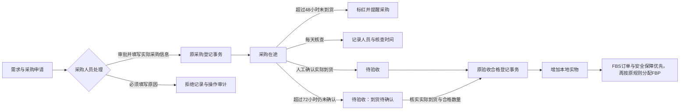

本地验证：68项定向检查通过，包含审批实际采购、申请精确关联、企业隔离、仓库金额不可见、48/72小时边界、到货/重复到货不加库存、原收货事务、拒绝原因、备注冲突、撤销成员权限、一天周期及规则版本、通知每天去重。构建、UTF-8、SQL绑定与API文档检查通过。旧 `inventory-alert-product-view` 中9项失败已在未修改的 `63a3a01` 基线复现，不作为本轮通过项；其中生产周期的定向测试通过。浏览器使用本地内存演示验证，不能替代真实员工业务验收；本节不表示已部署ECS。


## 经营首页库存商品销售榜（2026-10-30）

- 首页榜单以库存商品为单位，先汇总当前企业、所选北京时间日期内的有效销售，再按人民币销售额降序取前十；同额按库存 ID 稳定排序。
- 优先沿用订单行保存的本企业店铺绑定；缺失时按本企业店铺和 SKU 的有效绑定补查。未绑定 SKU 不混入未知商品；套装按绑定的库存商品展示，不向组件重复分摊整单销售额。销量是销售套数／件数，不是组件耗用数。
- 悬浮时按需读取前五个店铺／SKU 概览；点击名称或“明细”打开分页明细，列出店铺、SKU、销售额、有效单量和销量。同一订单多个 SKU 的单量不可直接相加。
- 榜单区域高度固定，默认只展示前十且不出现内部滚动条。点击“往下查看更多”后开启区域内滚动，每次追加十条，不挤压下方页面；“收起”恢复前十。切换日期或账号／企业后清空已展开内容与悬浮缓存。
- 接口为 `/api/profit-ranking?inventory=1&dimension=product`，明细使用 `dimension=sku&productId=库存商品ID`；保持旧报表调用和历史利润计算不变。

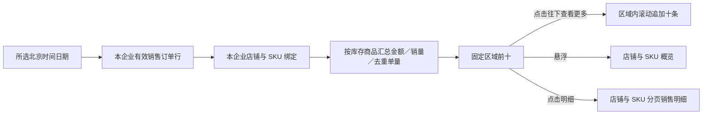


## 库存核对与入仓证据（2026-10-30 后续优化）

### 采购申请与组成识别

- 申请列表和节点悬浮统一显示申请人、申请时间、数量与状态。历史系统自动订单缺口以“系统规则”标识；人工创建保留真人姓名，无法核实的旧人员不冒充系统。
- 订单原因精简为“真实订单创建 · 订单号”，拒绝原因单独展示，完整原文留在“完整说明”，不覆盖历史备注。
- 商品库存和订单库存绑定选择表复用同一个类型徽标：有子产品组成显示套装，否则按库存配件标记区分配件与单品。悬浮后才读取子产品主图、名称、库存编码和组成数量，不读取费用或利润。不可访问的组成明确标记不完整。

### FBP逐项入仓核对

- 库存管理模式增加“FBP入库确认”，以及返回现有订单处理的按钮。流程图“发往FBP／到仓签收”复用同一核对组件。
- 默认只读待确认发仓记录，50条分页；可查看已确认历史，使用同一套库存结构化搜索。
- 新发运在原事务内保存当时已同步的官方实物快照作为对比基准，记录在企业隔离的 `inventory_flow_events`。GET不补造基准；旧批次没有发运前证据时明确提示人工核对。
- 供人工参考的推测补入量＝当前官方实物－基准实物＋快照区间内系统已记录的FBP出库，按同店铺、同SKU核对；套装多组件出库按订单商品行去重，避免重复计算SKU套数。已记录出库不保证等同官方瞬时扣减，库存同步时差、退货、调账或多批同SKU同时到仓均可能影响结果。
- **推测结果只显示“疑似已入仓／疑似部分入仓”，绝不自动确认。** 仓库逐SKU核对凭证后，沿用原发仓记录的实收确认，可部分确认；必须核对已确认数量，避免重复入仓。仍未收齐的其他SKU继续待确认，原备货单仅在全数确认后按原流程完成。
- 人工实收确认不会再次扣本地库存，不覆盖Ozon官方快照；沿用原有FBP入库记账，并增加实际确认人的审计记录。新入口在同一事务内重查仓库或库存管理权限。
- 预计到仓时间优先用发仓记录，缺省按本库存／企业配置的FBP发运天数计算（未配置为7天）。预计与实际到仓时间均可人工登记，按北京时间显示并校验并发改动；登记时间不等于确认数量。
- 到期无增长提示“到仓超时，需复核”；同备货单已有其他SKU确认时额外提示检查剩余SKU。提示需要人工查物流、签收、上架与异常原因，不直接判为丢失或自动扣损。

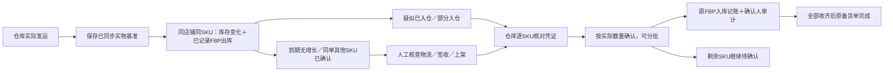

### 性能与首页密度

- 本地库存明细与FBP已保存快照并行读取，本地数据完成即展示；仅更新本地实物的直达入口不查询FBP。官方同步独立后台处理。
- 多SKU同步保留原绑定与企业校验，改为每家店铺先锁定相关绑定、集中读取一次组成，避免每个SKU重读整件库存全部绑定。
- 首页榜单销售查询只计算有效销售额、销量和去重单量，不附带利润费用或广告报表查询；原财务报表调用不变。
- 每页最多15个库存商品；点击查看更多后才启用内部追加，接近底部预取下一页，滚动期间暂停悬浮概览请求。收起／再次展开复用当次已加载数据，切换日期或企业清空。
- 固定高度内按实际可用宽度展示10、12或15个商品（两列五行、三列四行或三列五行），不挤压下面内容。数据库仍需对日期范围内销售聚合，分页不代表不扫描聚合输入；本次减少附带计算与请求竞争，不宣称消除所有聚合成本。


## 2026-10-31 采购工作台核对状态与翻页

- “待核对”是数据状态，不是预测一直运行。共享工作流返回本地账面原数、保障目标和核对原因；账面为负时保留负数证据，缺口及采购总数保持未知，先盘点，不能擅自清零或自动补写生产数据。
- FBP预测区分未绑定SKU、缺少SKU库存快照、目标或组成不完整；已同步的零库存与从未同步严格区分。单个SKU缺少快照不抹掉其他SKU的已知可售值，但完整总预测仍不冒充已核实。
- 必须采购只展示未覆盖的真实订单/正式申请缺口；在途能全覆盖时退出必须采购，采购到货任务仍可跟踪。部分覆盖时建议采购只补净缺口，现货与在途只抵扣一次，未来到货不等于当前可发。
- 工具按钮移至重新核算所在右侧区域；增加FBP到货验收任务卡，复用原FBP入库确认，和本地采购到货/验收入库分开。卡片统计只读取批次数与待确认量，不重复读取全部SKU验收证据。
- 翻页仅预读下一页，最多缓存6页、20秒，按会话与完整筛选条件隔离；变更通知、手工刷新、切换筛选、采购后及离开页面均失效。采购登记仍实时核对，缓存不参与写入判断。列表compact模式不读取不展示的人员申请/提醒历史；在途批次保持显示。

```mermaid
flowchart LR
  D[真实订单和正式FBP申请] --> C[统一分配现货与采购在途]
  C -->|完全覆盖| T[退出必须采购；在途任务继续跟踪]
  C -->|部分覆盖| G[只建议补剩余缺口]
  C -->|账面负数或证据缺失| R[显示具体原因；先盘点核对]
  F[FBP预测] --> K{SKU快照完整？}
  K -->|否| U[显示缺少的SKU数量；人工同步]
  K -->|是| A[黄色建议；不自动占库存]
  T --> L[本地采购到货与验收入库]
  A --> S[发往FBP]
  S --> V[FBP到货验收；仓库逐SKU确认]
```

## 2026-10-31 采购核对列表：库存事实与需求缺口分开

- 两条库存线同时展示：本地实物为本地账面事实；FBP实物为同企业、已绑定店铺/SKU的官方快照按组成折算后的实物数。FBP可售扣除了官方预留，不改名冒充实物；FBP实物不抵扣本地订单。
- 需求区复用公共分配结果，区分“待补数量”和“净采购数量”。FBS订单及本地保障无缺口时收起；有采购在途覆盖但尚未到货时仍显示待补数量和在途覆盖，采购建议可以为零。
- 正式FBP申请展示申请需求、本地可供、采购在途覆盖、必须采购；已确认锁定因盘点出现的缺货仍需展示。预测展示官方库存相对目标的缺口、发往FBP在途、已确认备货、同SKU申请抵扣后的待申请数量，以及本地可供、采购在途覆盖、建议采购。
- 同店铺/SKU预测转正式申请后不重复采购；“FBP缺100件、本地可供51件、采购在途覆盖49件、建议采购0件”表示仍需调拨/到仓，不代表FBP已经不缺货。不同店铺/SKU不能用汇总余量相互抵销缺口。
- 保持原采购分配、写入和权限规则；仅将已分配的现货/在途覆盖量随公共计划返回，页面不另建分配算法。读取FBP实物复用已有批查，不增加每行同步请求。未知或负本地账面不冒充零库存；官方快照不完整时FBP实物和总缺口保持待核对，已知本地数量仍独立展示。

```mermaid
flowchart LR
  Local[本地实物事实] --> Allocation[复用统一现货与采购在途分配]
  Purchase[采购在途事实] --> Allocation
  Official[FBP官方快照：实物与可售分开] --> Forecast[按店铺与SKU预测具体缺口]
  Forecast --> Covered[扣除发仓在途、已确认及同SKU申请]
  Covered --> Allocation
  Application[正式FBP申请] --> Allocation
  Orders[FBS真实订单] --> Allocation
  Safety[本地保障目标] --> Allocation
  Allocation --> Display[列表显示：待补量、现货覆盖、在途覆盖、净采购量]
  Display --> Details[点击复用订单、保障规则、申请与预测明细]
```

本节为本地开发说明；是否部署以正式发布记录为准，不将本地演示当作真实采购业务验收。

### 待到货批次纠错与两步快速入库

- 采购待到货、到货待验收卡片同时显示批次数与待处理件数，数量统计复用现有筛选与企业范围。
- 未到货批次提供确认到货、编辑、删除。编辑直接打开当前批次的数量、货款、运费、快递公司、单号与原因；删除用于重复或误录，作为作废保留审计，不将实际退款等同于删除。
- 统一采购对账新增 `revise_pending_batch`，在原有成员、库存归属、完整 revision、事务锁及幂等检查下处理。正式采购复用 `revise_purchase` 的采购单/明细/申请/覆盖/成本版本纠正；拆批时只修改选中待到货批次，保留其他批次及已入库记录。旧采购申请直连的在途批次同步纠正其原采购申请与分配，不凭空创建正式采购或入库流水。缺失有效来源、已到货或已入库的记录不能从待到货入口改账。
- 登记入库复用一个公共快速面板。列表直接打开，不先进入完整库存详情；流程图也使用同一面板。第一步显示库存基本信息、当前实物、当前可用和本次入库数量；仅差异行要求原因。第二步用后端只读预览显示实物/可用数量前后变化，再确认入库，不叠加额外确认弹框。
- 新预览和上下文接口仅对当前企业的仓库或采购岗位开放，不读取费用或调用FBP同步。普通到货按原收货事务登记；历史出库、盘点或负账面时，要求核实包含本次到货的实际总数，不能自动猜数。确认携带预览 revision，证据变化后拒绝旧确认；未收部分仍保留待处理。

```mermaid
flowchart LR
  Queue[采购待到货：批次与件数] --> Arrived[确认到货：实物不增加]
  Queue --> Correction[编辑数量金额物流／作废误录]
  Correction --> Audit[原对账事务：修正来源与在途覆盖，保留审计]
  Arrived --> Entry[快速入库：当前实物、可用与实收数量]
  Entry --> Difference{数量有差异？}
  Difference -->|有| Reason[填写差异原因]
  Difference -->|无| Preview[预览实物与可用前后变化]
  Reason --> Preview
  Preview --> Count{存在历史出库／盘点／负账面？}
  Count -->|是| Verify[核实当前实物总数]
  Count -->|否| Confirm[确认入库]
  Verify --> Confirm
  Confirm --> Original[原收货事务：仅入库合格数量，余量保留]
```

### 登记采购打开性能（2026-10-31）

- 只读生产采样中，指定库存的最新需求复核约9.2秒；此前已指定商品仍执行的列表模糊搜索约2.6秒，完整单品资料约2秒，精简单品读取约76毫秒。这是单次采样，不承诺其他商品或负载下相同耗时。
- 库存核对列表点击登记采购立即打开表单，后台核对最新需求。核对未完成、失败、账面未核实或最新货源已覆盖时禁止提交；关闭、切换企业或离开页面后旧结果失效。实际提交仍使用原采购登记接口，不跳过权限、关联和真实采购信息检查。
- 已指定商品时不再发商品列表搜索，直接读取 `includeDetails=0&includeOperations=0` 精简资料。商品、采购人、供应商分别加载；人员或供应商慢请求不遮住整张表单，用户已经输入的信息不被迟到默认值覆盖。加载错误按对应内容提示，不冒充已加载。
- 本轮消除打开前的串行等待及无用查询；后端需求复核本身的耗时仍单独存在，不宣称已经将所有核算降至毫秒级。
